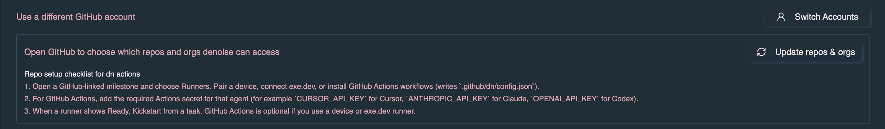
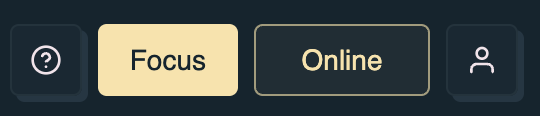
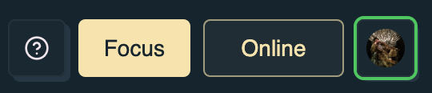

The app supports optional sign-in. A sync badge in the header shows whether
denoise is connected to the server (**Offline**, **Online**, or **Syncing…**).
The badge is view-only. You can use denoise without logging in; authentication
determines what syncs while the app is connected.

## Sign-in and sign-up

Sign-in and sign-up happen through the subscribe funnel on `/` and
[denoise.cloud/subscribe](https://denoise.cloud/subscribe) (`/subscribe`), not
on Profile.

- Existing account: **Sign in** at the top of the page.
- New Pro plan: **Start 14-day free trial** when signed in (**Sign in for free
  trial** when signed out), or **Sign in to subscribe — $6/mo**.
- Team plan: **Subscribe to Team**.
- Free solo use: **Continue in The Void**.

The subscribe gate starts GitHub-only OAuth (`flow=oauth_only`). Complete the
flow in your browser, and you are redirected back to the app with a session.
Your session is stored in a cookie and validated by the server. A trial counts
as Pro for workbench access.

GitHub sign-in is required for
[GitHub integration](/denoise/github-integration/) (linking milestones, syncing
issues, converting tasks to issues, and dn workflow dispatch).

### GitHub App and repository access

GitHub sign-in uses a **GitHub App** (user-to-server). On first sign-in you may
see GitHub’s app installation or authorization screen, depending on how denoise
is deployed. You choose which repositories and organizations denoise can access.

After sign-in, manage access from **Profile**:

| Action                  | When to use                                                                                                  |
| ----------------------- | ------------------------------------------------------------------------------------------------------------ |
| **Switch Accounts**     | Use a different GitHub account.                                                                              |
| **Update repos & orgs** | Open GitHub to choose which repos and orgs denoise can access for milestones, issues, and workflow dispatch. |

When GitHub is connected, the same card includes a **Repo setup checklist for dn
actions**: pair a runner or install workflows from a linked milestone, add the
Actions secret for that agent when you use GitHub Actions, then kickstart once a
runner shows Ready.

You can also review installations at
[github.com/settings/installations](https://github.com/settings/installations).

Repository access must include any repo you link to a milestone. If linking or
sync fails with a permissions error, use **Update repos & orgs** and confirm the
target repository is granted access.

## Using the app without signing in

You can use denoise without signing in. In that case:

- All data stays **local** (IndexedDB). Tasks and milestones are stored only on
  your device.
- You can create and edit tasks, use milestones, and use the focus timer.
- GitHub integration (link milestone, create issue, sync with GitHub) is not
  available.

The app works locally first. Sign-in adds cloud sync and collaboration when the
badge shows **Online**.

## Sync badge

The header sync badge is view-only. It reports whether the app is connected to
the server.

| State        | Meaning                      |
| ------------ | ---------------------------- |
| **Offline**  | Not connected to the server. |
| **Syncing…** | Connecting to the server.    |
| **Online**   | Connected to the server.     |

## How authentication and the sync badge interact

### When you are signed in (GitHub or Google)

- **Online** works fully:
  - **Milestone sync** — Your milestones (create, update, delete, share) sync to
    the server and are available on other devices and to collaborators.
  - **Todo sync** — Todos for the current milestone sync in real time. Data is
    stored in the cloud (Deno KV) and keyed by your user id or milestone id.
- **Offline** — Everything is local only; no server connection.

### When you are not signed in

- **Offline** — Same as above: everything is local.
- **Online** — Behavior is limited:
  - **Milestone sync is not available.** The server requires authentication for
    uploading or requesting milestones. So you cannot sync milestones across
    devices or use sharing when not signed in.
  - **Todo sync** can still work **only when a milestone is open.**\
    The app needs a “list id” to connect (either your user id or a milestone
    id). When you’re not signed in, there is no user id. If no milestone is
    open, there is no list id, so the WebSocket never connects and the badge
    will stay **Offline** (or show **Syncing…** then fall back to **Offline**
    after a few seconds).\
    If you **open a milestone** from the workspace, the list id is that
    milestone’s id. The server accepts the connection as an anonymous user and
    syncs todos for that list to the cloud. So you get real-time todo sync for
    that one list only, without a stable account or cross-device identity.

In short: **online without signing in** = todo sync for the currently open
milestone only; no milestone sync and no persistent identity across devices.

## Summary

| Signed in? | Badge   | Result                                                           |
| ---------- | ------- | ---------------------------------------------------------------- |
| No         | Offline | Local only; no server.                                           |
| No         | Online  | Todo sync only when a milestone is open; no milestone sync.      |
| Yes        | Offline | Local only; no server.                                           |
| Yes        | Online  | Full sync: milestones and todos, multi-device and collaboration. |

For full cloud sync, cross-device use, and GitHub integration, sign in (GitHub
for GitHub features, or Google for identity and sync). The badge shows
**Online** when the app is connected to the server.
