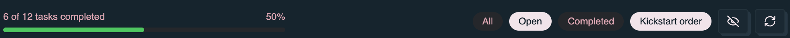
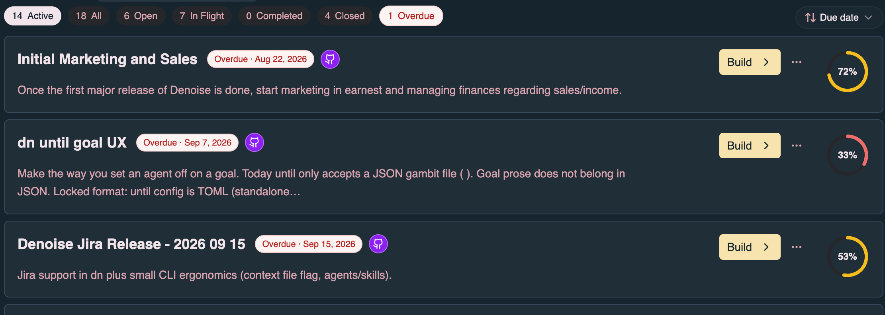
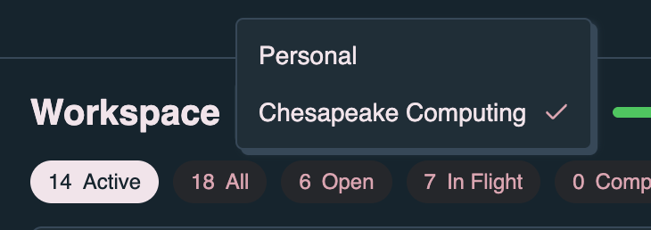
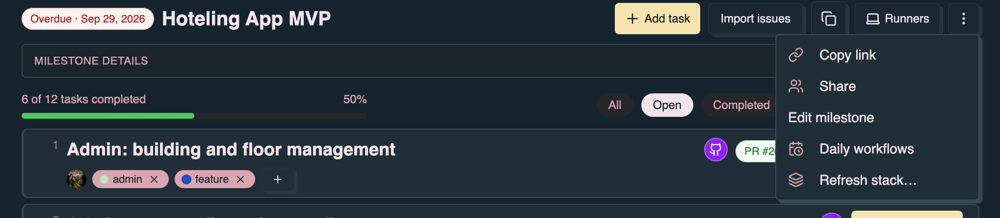
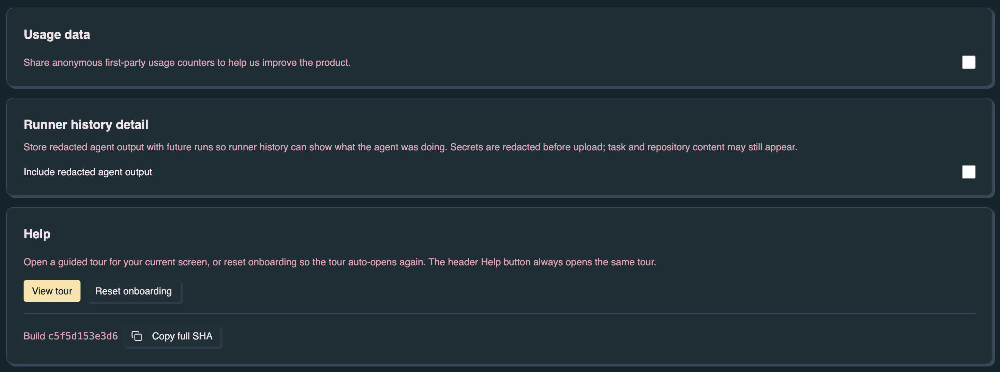

## Overview

Denoise is a planning stack for small software teams. **The Void** covers free
solo tasks that stay on a paired laptop. **denoise** (Denoise Pro) is the
collaborative workspace and milestone app with GitHub sync and dn-powered
automation.

In the team app, the default experience is **workspace-first**: open the
workspace to see milestones, then open a milestone to manage its tasks. A
progress bar at the top shows how many tasks are completed. See
[Getting started](/denoise/getting-started/) for Free vs Pro entry points and
[The Void](/denoise/void/) for the free product.

[Denoise Pro](/denoise/subscription-and-pro/) adds task kickstart, repository
initialization, and workflow dispatch from the app UI on GitHub-linked
milestones. See [Milestone details](/denoise/milestone-details/) for the full
milestone view workflow.

## Core features

- **The Void (Free)** — Solo local tasks that sync to a paired laptop. See
  [The Void](/denoise/void/).
- **Workspace and milestones (Pro)** — Group tasks into milestones and track
  progress from the workspace. See [Getting started](/denoise/getting-started/).
- **Focus timer** — Start a focused work session from **Focus** in the header.
  See [Focus timer](#focus-timer).
- **Collaboration (Pro)** — Share milestones and control who sees tasks. See
  [Collaboration](#collaboration).
- **GitHub issue sync (Pro)** — Link milestones and keep tasks in sync with
  GitHub issues. See [GitHub integration](/denoise/github-integration/).
- **Task kickstart (Pro)** — Start agent planning and implementation from a
  task. See [Milestone details](/denoise/milestone-details/) and
  [Kickstart](/kickstart/).
- **Organizations (Team)** — Org seats and shared billing so teammates get Pro
  through an assigned seat. See
  [Subscription & Pro — Organization and Team](/denoise/subscription-and-pro/#organization-and-team).

## Task management

Tasks live on the **milestone view**. Open a milestone from your workspace to
reach them.

_Milestone view — Denoise tasks and GitHub-imported issues in one list._

Click **Add task** to open the new task modal, then choose a new Denoise task or
an existing GitHub issue. A Denoise task takes a title, labels, and a markdown
description.

Each task appears as a row in the milestone list. From the row you can mark the
task complete or reopen it. Click the row to open the task detail dialog, where
you can edit the title and description, delete the task, or set tags, a due
date, and an urgent flag. Tags on GitHub-linked tasks sync as GitHub labels.

### Filtering tasks

The strip under the milestone header shows a progress bar and filter chips:
**All**, **Open**, and **Completed**. The refresh icon pulls the latest GitHub
issues.

On a GitHub-linked milestone, **Initialize stack** from the overflow menu ranks
issues and enables **Kickstart order**. See
[Milestone details — Initialize or refresh the stack](/denoise/milestone-details/#initialize-or-refresh-the-stack).

**Kickstart order** — Click the **Kickstart order** chip to sort tasks by that
stack priority.

**Hide completed tasks** — Click the eye icon in the filter row to hide
completed tasks. When enabled, only incomplete tasks are shown.

<video autoplay loop muted playsinline class="demo-video" aria-label="Kickstart order — toggle to sort tasks by kickstart plan priority">
  <source src="/demos/kickstart-order.mp4" type="video/mp4" />
</video>

## Focus timer

Click **Focus** in the header to start a Pomodoro-style focus session. Choose
the session length in **Profile** → **Display Settings** (25 min, 50 min, or 2
hours).

## Milestones

Milestones help you organize tasks into groups or projects:

1. On the **workspace**, click **New milestone**.
2. Enter a name, choose a **Kickstart publish default** (**Pull request** or
   **Direct to trunk**), and add an optional description and due date. Then
   click **Create**.
3. Open the milestone from the workspace to add and manage tasks.

Use the workspace selector when you belong to more than one organization. Open
the menu beside **Workspace** and choose **Personal** or an organization. The
milestone list updates to that workspace.

<video autoplay loop muted playsinline class="demo-video" aria-label="Switch workspace — open the menu and choose Personal or an organization">
  <source src="/demos/switch-workspace.mp4" type="video/mp4" />
</video>

### Filtering milestones

On the workspace, use the status chips (**Active**, **All**, **Open**, **In
Flight**, **Completed**, **Closed**, **Overdue**) and the **Due date** sort to
narrow the milestone list.

## Collaboration

Share a milestone from the header overflow menu (**Share**). That opens **Manage
Participants**, where you add people who can open the milestone. Shared
milestones sync in real time when the sync badge shows **Online** and you are
signed in.

Sharing the milestone is what invites collaborators. Per-task privacy is
separate:

- In a personal milestone (no participants), new tasks default to **private** —
  only you see them.
- In a shared milestone, new tasks are visible to participants by default.
- If a task is still private, open its overflow menu and choose **Publish** so
  participants can see it. **Unpublish** hides it from them again (owner only).

Collaborators can be added by searching for their Github user within the
collaborator search once they have created a denoise account. The user must be
signed into the matching account to view milestones they have been added as a
collaborator on.

## The Void

[The Void](/denoise/void/) is the free solo task list. Tasks sync to a paired
laptop under `~/.dn/tasks/` via device runners; denoise does not keep a
long-term cloud todo store for free tasks. There are no milestones in The Void.

See the dedicated page for pairing, Free vs Pro distinctions, and ticketless
kickstart.

## Profile: usage, runner history, and help

On **Profile** (`/profile`), these panels sit together:

- **Usage data** — Enable **Share anonymous first-party usage counters to help
  us improve the product**. Counts include events such as upgrade clicks and
  milestone and task totals. When enabled, they are stored with the rest of the
  app data (Postgres in production) and included in backups.
- **Runner history detail** — Enable **Include redacted agent output** to store
  redacted agent output with future runs, so runner history can show what the
  agent was doing. Secrets are redacted before upload. Task and repository
  content may still appear.
- **Help** — **View tour** opens the guided tour for your current screen.
  **Reset onboarding** makes that tour auto-open again on the next load. The
  same card shows the current build and **Copy full SHA**. The header **Help**
  button opens the same tour.

## Related

- [Kickstart](/kickstart/) — How kickstart turns a task into a plan and
  implementation
- [Runners](/runners/device-runners/) — Pair a device or connect exe.dev
- [Kickstart runtimes](/runners/kickstart-runtimes/) — Where kickstart runs
- [Runner logs](/runners/runner-logs/) — Serve stdout for devices and exe.dev
- [`dn` release notes](https://github.com/chesapeakedev/dn/releases)
- [Roadmap](/roadmap/) — What we intend to build next
