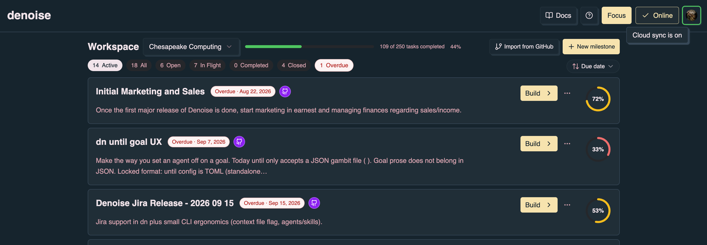
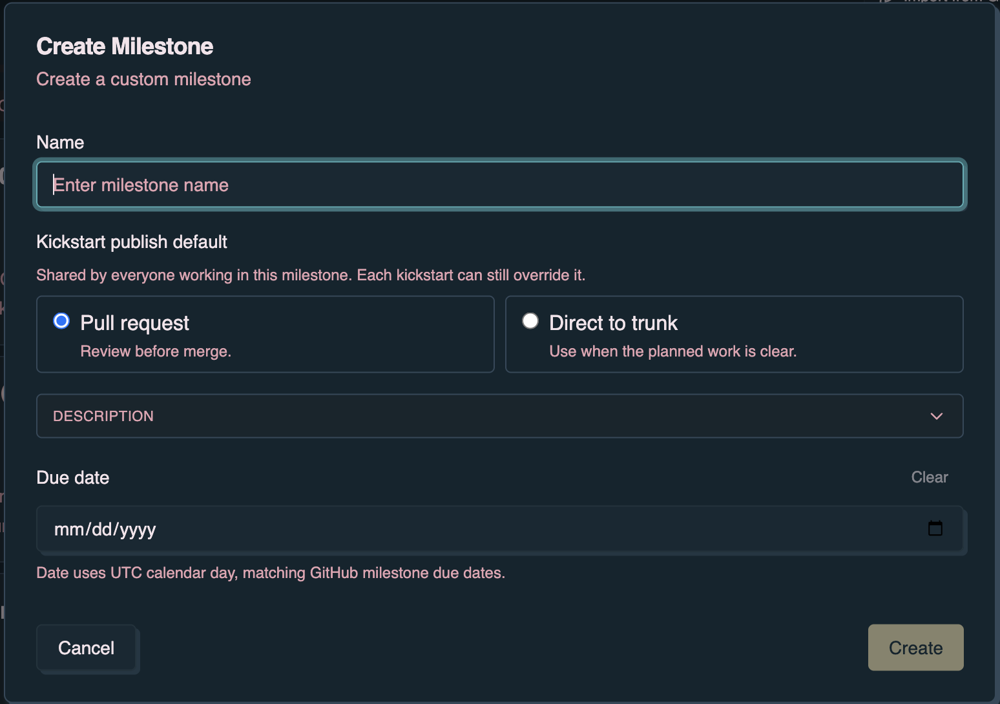
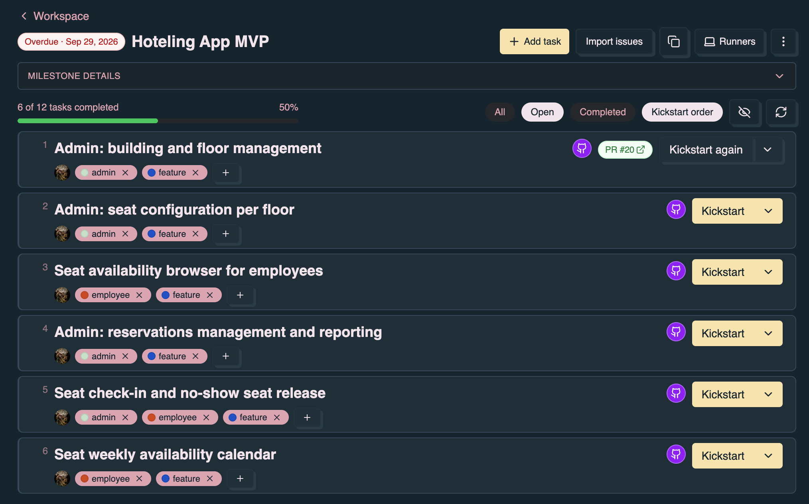
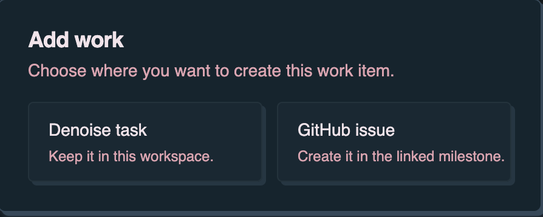
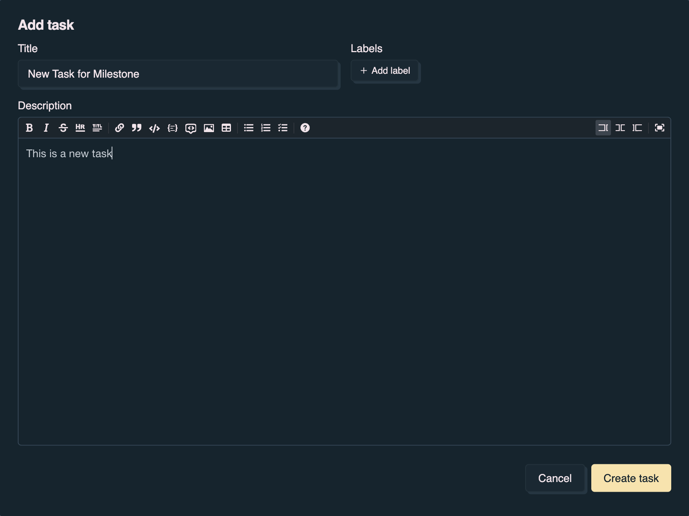
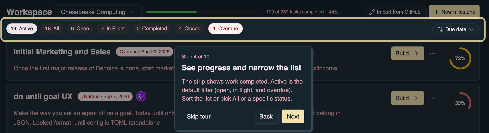

Use this page to choose the right product surface, sign in, and create a first
task. Start here when you are using the app UI rather than the `dn` CLI.

## Choose Free or Pro

| Product             | URL                                              | When to use it                                                         |
| ------------------- | ------------------------------------------------ | ---------------------------------------------------------------------- |
| **The Void** (Free) | [void.denoise.cloud](https://void.denoise.cloud) | Solo local tasks that sync to a paired laptop via `dn`. No milestones. |
| **denoise** (Pro)   | [denoise.cloud](https://denoise.cloud)           | Workspace, milestones, GitHub sync, and kickstart from the app.        |

Signing in at denoise.cloud without Pro lands on `/subscribe`. Choose **Continue
in The Void** for solo use, or subscribe for the collaboration and milestone
tracking with **Workspaces**. See [The Void](/denoise/void/) and
[Subscription & Pro](/denoise/subscription-and-pro/).

## The Denoise Web App

When you have a Denoise Pro subscription, denoise opens to the **workspace
page**, a project-level view of your milestones. Open a milestone in your (or
your organization's) workspace to manage its tasks on the **milestone view**.

| View               | Route            | When                                      |
| ------------------ | ---------------- | ----------------------------------------- |
| **Workspace**      | `/`              | Default home for Pro / team use           |
| **Milestone view** | `/milestone/:id` | Open a milestone from the workspace       |
| **Profile**        | `/profile`       | GitHub access, plan, and display settings |

_Workspace: track milestone progress from the app homepage._

Github milestones can be imported to a workspace for immediate implementation
via the milestone view. Users can also create fresh milestones and tasks that
are solely tracked in denoise.

The header shows a sync badge (**Offline**, **Online**, or **Syncing…**) that
keeps the user aware of their connection to the server. Open the **Profile
page** by clicking on the profile avatar to access account settings.

## Authentication

Unauthenticated users are redirected to the **Subscription page**, while Pro
users go straight through to the the app. From the subscription page, the user
has a few options:

- Log in to existing Pro account by clicking **Sign in** at the top of the page.
- Start a free Pro trial by clicking the recommended option
- Create a Team account, which creates an organization that you can add users to
  (includes 6 seats)
- **Continue in The Void** for free solo use, without a denoise subscription

All subscriptions are associated with a valid Github account, so in order to
create an account and start a trial, team organization, etc you will need to
authenticate with Github.

Authentication cookies are shared across denoise.cloud and void.denoise.cloud.
For sign-in behavior, repository access, and how the sync badge interacts with
authentication, see [Authentication](/denoise/authentication/).

## Creating your first task

### Free — The Void

1. Open [void.denoise.cloud](https://void.denoise.cloud).
2. Optionally sign in and pair a device runner so tasks land under
   `~/.dn/tasks/` on your laptop.
3. Type a task title and add it.

See [The Void](/denoise/void/) for local sync and ticketless kickstart.

### Pro — Denoise Workspace

On the workspace page:

1. Click **New milestone** on the workspace page.
2. Enter a name, choose a **Kickstart publish default** (**Pull request** or
   **Direct to trunk**), and add an optional description and due date. Then
   click **Create**.

1. Open the milestone from the workspace.
2. Click **Add task** in the milestone header.

1. In **Add work**, choose **Denoise task** or **GitHub issue**. Enter a title
   and description, then create the task or issue.

1. Confirm the task appears in the milestone task list.

Use the header **Help** button to open a guided tour for your current screen. On
the workspace, the tour points at the progress strip and the status filters.
**Active** is the default filter (open, in flight, and overdue).

## Next steps

- Use [The Void](/denoise/void/) for free solo tasks and local `dn` sync.
- Use [Features](/denoise/features/) to learn milestones, collaboration, and
  GitHub sync in the team app.
- Use [GitHub integration](/denoise/github-integration/) when you want to link
  milestones to GitHub issues and dn workflows.
- Use [Milestone details](/denoise/milestone-details/) for Runners, stack
  ranking, and per-task kickstart on GitHub-linked milestones.
- Use [Subscription & Pro](/denoise/subscription-and-pro/) for Free vs Pro vs
  Team.
- Use [Runners](/runners/device-runners/) when you want Void task-sync or Pro
  kickstart on a trusted local checkout.
