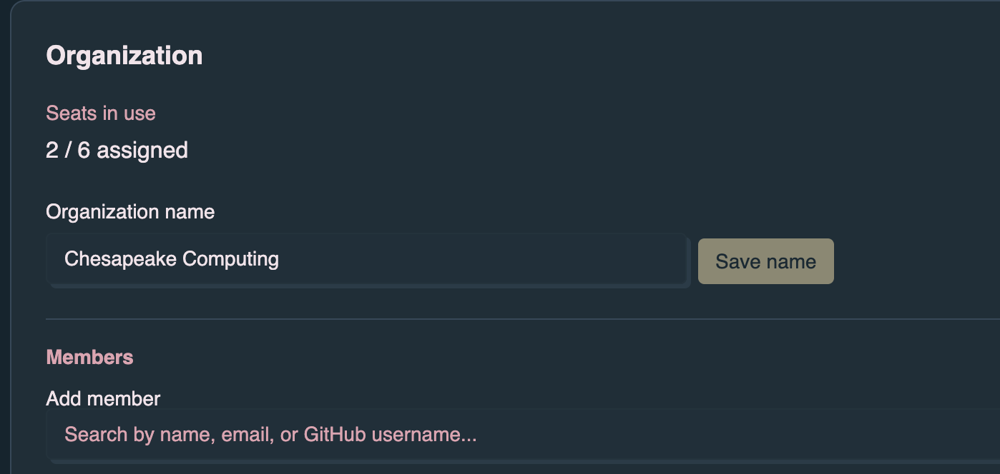

**The Void** is free for solo local tasks. **Denoise Pro** unlocks the denoise
team app — milestones, workspace, GitHub sync, and agent-backed automation from
the UI. **Denoise Team** adds org seats and shared billing.

## Free vs Pro vs Team

| Capability                                     | Free (The Void) | Denoise Pro            | Denoise Team           |
| ---------------------------------------------- | --------------- | ---------------------- | ---------------------- |
| Access to The Void                             | Yes             | Yes                    | Yes                    |
| Local tasks via paired runner (`~/.dn/tasks/`) | Yes (1 runner)  | Yes (up to 10 runners) | Yes (up to 10 runners) |
| Plan in web & handoff to agents                | No              | Yes                    | Yes                    |
| Shared agent & human workspace                 | No              | Yes                    | Yes                    |
| Orgs & shared billing                          | No              | No                     | Yes                    |

Denoise Pro is **$6/month** with a **14-day free trial**. Denoise Team is
**$20/month** for 6 seats plus **$2 per additional seat**. See in-app Plan &
billing for the live price.

Signing in at denoise.cloud without Pro lands on `/subscribe`. The gate shows
the plan table and **Continue in The Void** for solo use.

## What Pro includes

Pro unlocks the denoise team app and the automation around it:

- **Workspace and milestones** — Plan projects in the web app with cloud sync.
  See [Getting started](/denoise/getting-started/) and
  [Features](/denoise/features/).
- **Task kickstart** — Start agent planning and implementation from a task in
  the milestone view. See [Milestone details](/denoise/milestone-details/) and
  [Kickstart](/kickstart/).
- **Collaboration** — Share milestones and keep tasks visible to participants.
  See [Features — Collaboration](/denoise/features/#collaboration).
- **GitHub-backed automation** — Link milestones, install `dn` workflows, rank
  issues, and dispatch kickstart from the app. See
  [GitHub integration](/denoise/github-integration/) and
  [Milestone details](/denoise/milestone-details/).
- **Void GitHub import** — Import or close GitHub issues from The Void. See
  [The Void](/denoise/void/).
- **Early access** — Priority feedback channels and early access to new
  productivity features as they ship.

## Manage your plan

1. Open [denoise.cloud/subscribe](https://denoise.cloud/subscribe) and sign in,
   or start a trial or subscription from that page.
2. After you finish checkout, denoise confirms when Pro is active. If the app
   still shows the free plan for a moment, wait and refresh — the update can
   take a few seconds.
3. Later, click the avatar in the header to open **Profile**. Under **Plan &
   billing**, view your current plan or upgrade.

## Organization and Team

If your account belongs to an organization with managed seats, Pro access may
come from an assigned seat rather than a personal subscription (`effectivePro`
even when personal status is free). Organization admins see an **Organization**
section in Profile to manage members and seat assignments.

For repository automation prerequisites (workflows, secrets, milestone linking),
see [GitHub integration](/denoise/github-integration/) and
[Authentication](/denoise/authentication/).

## Related pages

- [The Void](/denoise/void/) — Free solo product and local task sync
- [Features](/denoise/features/) — Tasks, milestones, collaboration
- [Milestone details](/denoise/milestone-details/) — DN setup, init_stack,
  kickstart order, and per-task kickstart
- [GitHub integration](/denoise/github-integration/) — Link milestones and sync
  issues
- [Tips & troubleshooting](/denoise/tips-troubleshooting/) — When Pro-gated
  actions are disabled
- [Runners](/runners/device-runners/) — Runner limits on Free vs Pro
- [Runners](/runners/overview/) — runner setup and guidance
